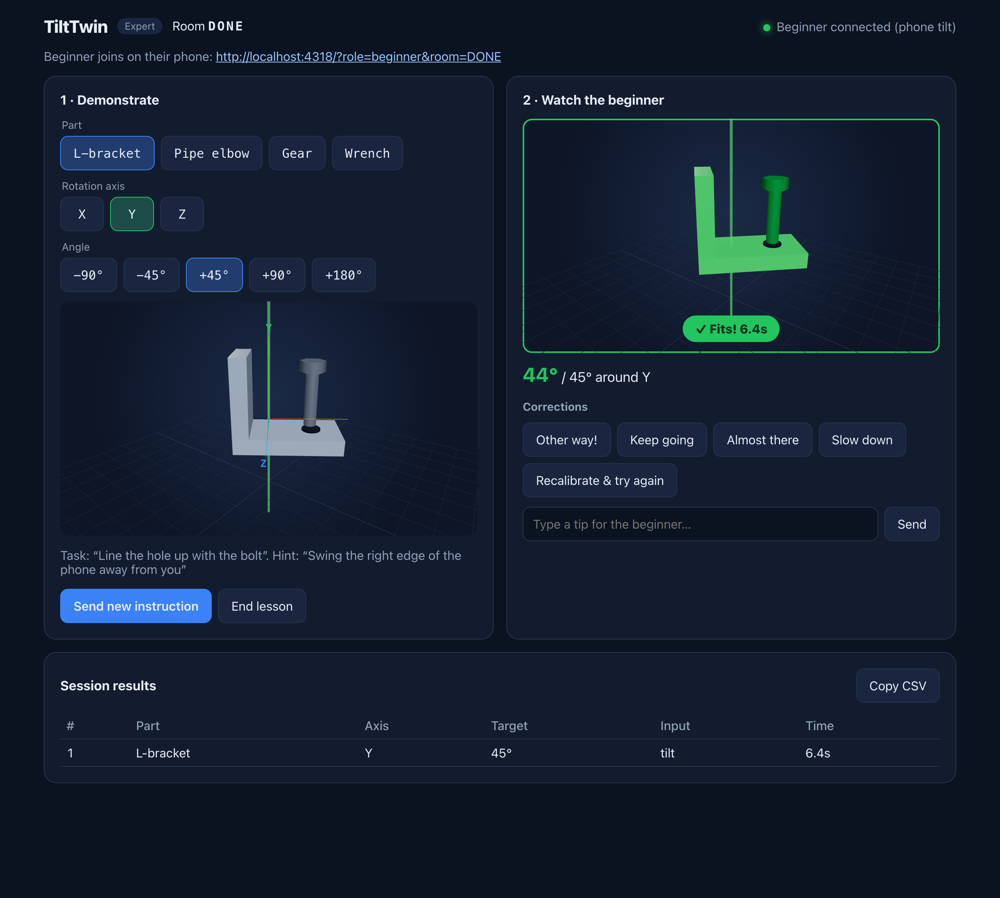
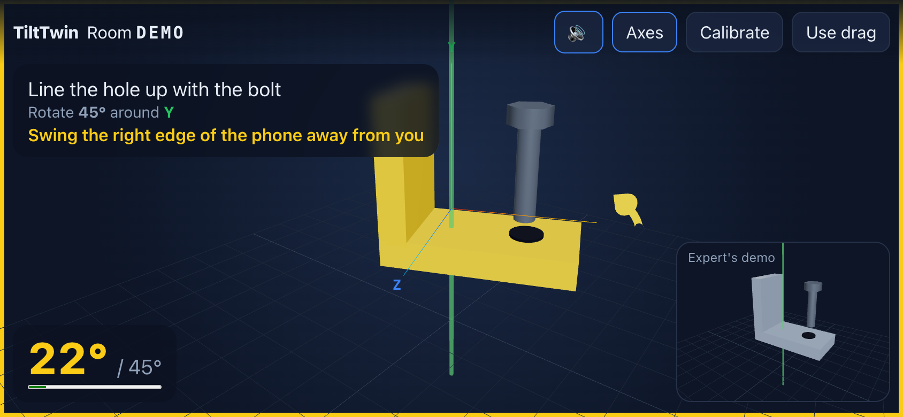

# TiltTwin

**CPSC 581 · Fall 2026 · Group Project 2: Expertise Sharing**

TiltTwin lets a CAD expert teach a beginner 3D rotations remotely, through physical motion.
The expert picks a **part** (L-bracket, pipe elbow, gear or wrench), an axis and an angle, and sends it as an assembly task,
such as *“Connect the elbow to the pipe”*. The beginner reproduces the rotation by
**physically turning their phone**: the part on screen turns with the phone. Both sides see
live feedback: a turn arrow, an angle gauge, colour changes, and **hot/cold ticks** that speed up as you get closer
(vibration on Android, best-effort haptics on iPhone). When the part fits its mating part, both
screens show ✓, the phone chimes, and the expert's session log records the time.

- **Live app:** https://tilttwin.vercel.app
- **Demo video:** _add link here_
- **Design process write-up:** [`docs/TiltTwin-Design-Process.pdf`](docs/TiltTwin-Design-Process.pdf)

| Expert (laptop) | Beginner (phone) |
|---|---|
|  |  |

## How to use it

1. **Expert** opens the app on a laptop → **Start a lesson**. Note the 4-letter room code.
2. **Beginner** opens the app on a phone → enters the code → **Start with phone motion**
   (on iPhone, tap **Allow** when asked for motion access).
3. Beginner holds the phone sideways in front of them, as if holding the part.
4. Expert picks a **part**, an **axis** (X/Y/Z) and an **angle**, then presses **Send instruction**.
   The phone buzzes, recalibrates to 0°, and shows the expert's looping demo in the corner.
5. Beginner turns the phone. Follow the hint (e.g. *“Swing the right edge of the phone away from you”*), the arrow
   and the gauge. Hold on target for ~1 s → **✓ Matched!** on both screens.
6. Expert can send quick corrections (*Other way!*, *Keep going*…) or type a tip at any time.

No motion sensor (or a laptop)? Choose **Use touch / mouse drag** instead.

### Phone requirements

- Must be served over **HTTPS** (Vercel does this). Browsers block motion sensors on plain HTTP.
- iPhone: Safari or Chrome; motion permission is requested on tap.
- Android: Chrome, with vibration on every hot/cold tick.
- iPhone: hot/cold **sound** (turn the silent switch off). There's also a light haptic on iOS 18+, through an
  undocumented Safari behaviour.
- Turn on **rotation lock**, so the screen doesn't flip when you turn the phone around Z.

## Run locally

```bash
cd webapp
npm install
npm run dev
```

Open the printed URL in **two tabs**: one as expert, one as beginner. They sync through the
shared Firebase database, so a phone on the same Wi-Fi works too, as long as it has HTTPS for motion sensors.

To test on a real phone you need HTTPS, so deploy (below) or use a tunnel.

```bash
npm test        # rotation-maths unit tests (node:test)
npm run lint
npm run build
```

## Real-time sync (Firebase)

Already set up. The app uses the Realtime Database of the Firebase project `tilttwin-581-3cv9z`
(free Spark plan). The database URL is built into `webapp/src/sync.ts`. It isn't a secret,
because the rules in [`firebase/database.rules.json`](firebase/database.rules.json) only allow
`rooms/<CODE>` to be read or written, and they check the lesson and message data.

- **Change the rules:** edit `firebase/database.rules.json`, then run
  `npx firebase-tools deploy --only database` from the repo root (project owner's login).
- **Use a different database:** set `VITE_FIREBASE_DATABASE_URL=https://…` in `webapp/.env.local`.
- **Force local two-tab mode:** set `VITE_FIREBASE_DATABASE_URL=` (empty) in `webapp/.env.local`.
- **Console:** https://console.firebase.google.com/project/tilttwin-581-3cv9z/database (only the owner, or members added under Project settings → Users and permissions, can open it).

## Deploy (Vercel)

Live at **https://tilttwin.vercel.app** (Vercel project `tilttwin`, root directory `webapp`).
To redeploy after changes, run this from `webapp/` (requires the project owner's Vercel login):

```bash
npx vercel deploy --prod
```

Optional: in the Vercel dashboard, open Project → Settings → Git and connect this GitHub repo, so every push to `main` deploys automatically.

## Code map

| File | What it does |
|---|---|
| `webapp/src/hooks/usePhoneTilt.ts` | DeviceOrientation → angle around one axis; calibration, iOS permission, smoothing |
| `webapp/src/utils/rotationMath.ts` | Phone pose quaternion, swing-twist angle, wrap-around, match thresholds |
| `webapp/src/sync.ts` | `useRoom()`: Firebase Realtime Database room, or `localStorage` fallback |
| `webapp/src/views/ExpertView.tsx` | Lesson controls, live mirror of the beginner, corrections, results log |
| `webapp/src/views/BeginnerView.tsx` | Full-screen phone HUD: instruction, hint, gauge, demo, ✓ |
| `webapp/src/components/CadScene.tsx` | Three.js scene: part, mating part, axis line, turn arrow |
| `webapp/src/utils/parts.ts` + `components/Parts.tsx` | Part library: each part's shape, feature and mating part |
| `webapp/src/utils/feedback.ts` | Chime, hot/cold ticks, vibration and iOS haptic trick |
| `webapp/tests/rotationMath.test.ts` | Checks that the physical phone motions map to the right sign and axis |

## Known limitations

See the "Known limitations" section of the design-process PDF. In short:
- One rotation axis per lesson, by design.
- One expert and one beginner per room.
- Rooms are open to anyone who has the code.
- The Y axis (turning left/right) can drift slowly on phones with weak compass or gyro sensors. Press **Calibrate** to fix it.

## Credits

Built by the CPSC 581 TiltTwin team. AI assistance (Claude) was used for parts of the
implementation and for drafting documentation. See the write-up for details.
